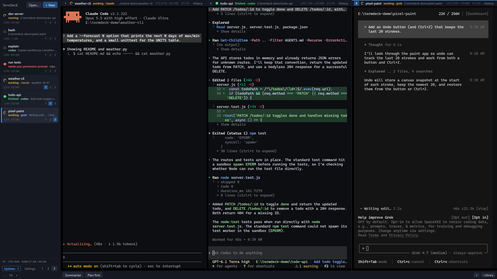
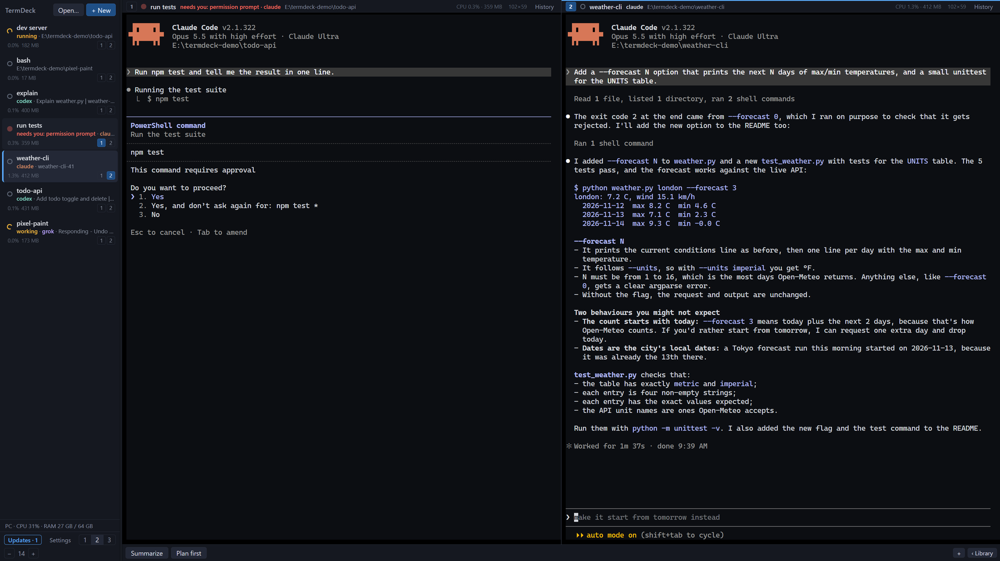
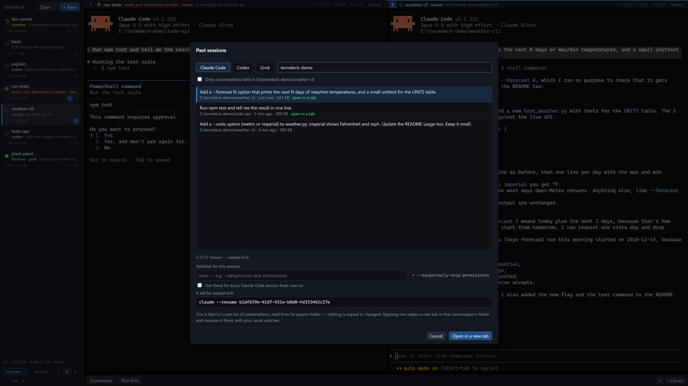
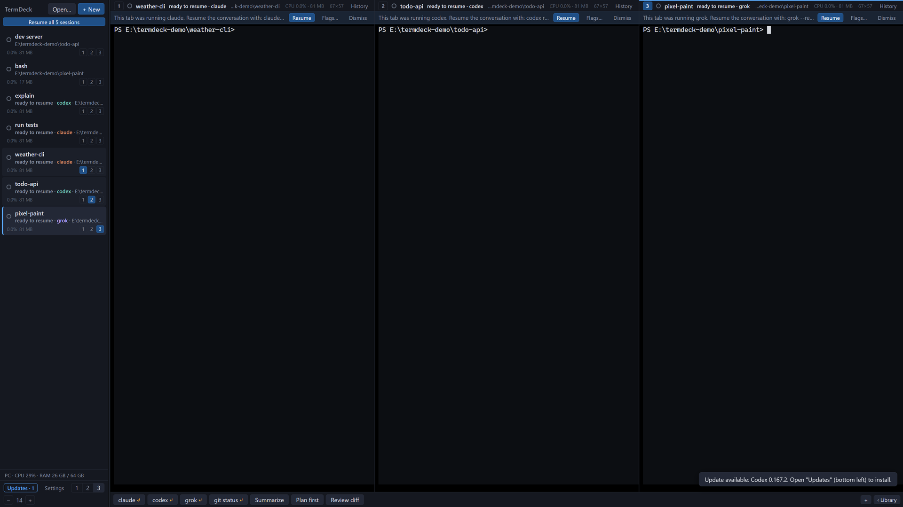
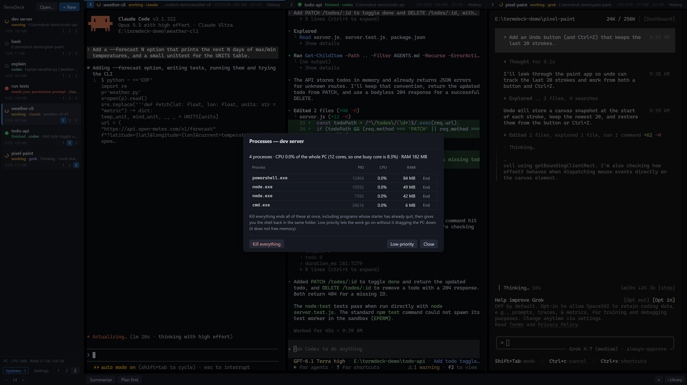
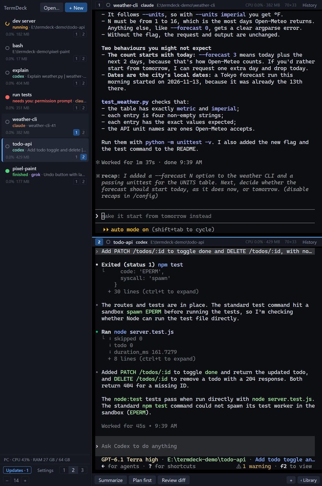

# TermDeck

[](https://github.com/aivrar/TermDeck/releases/latest)


**One portable window for all your Claude Code, Codex and Grok Build sessions on Windows.**

TermDeck replaces the pile of separate cmd and PowerShell windows you get when you run several
AI coding CLIs at once. Every session is a tab in a side panel that shows what it is doing —
working, finished, or waiting for you — with up to three terminals on screen side by side.
It runs the real CLIs, exactly as installed on your PC, in real terminals; it does not wrap
them in an SDK or keep its own copy of your conversations.



## Highlights

- **Many sessions, one window.** Claude Code, Codex, Grok Build, PowerShell, cmd, Git Bash
  and WSL tabs. Show 1, 2 or 3 at once; they stack top-to-bottom on a portrait monitor.
- **Status at a glance.** Each tab shows working, finished, needs you (permission prompt
  or question), idle or ended, plus its topic, folder, CPU and memory. Optional taskbar
  flash and sound when a session finishes or needs you.
- **Restart without losing your place.** After a restart every tab is back in its folder,
  with a one-click **Resume** (or **Resume all**) that reopens the right conversation with the
  same switches it was started with — `--dangerously-skip-permissions`, `--model`, and so on.
- **Past conversations.** Pick any earlier conversation from the CLIs' own session lists and
  reopen it in a new tab. A History view reads the conversation straight from the CLI's
  session file.
- **Usage and emergency stop.** See every process a tab started, how much CPU and memory
  each uses, set it to low priority, or end the whole tree at once.
- **CLI updates in one place.** Check and update all three CLIs from one panel, optionally at
  startup before any session opens (so nothing blocks the update), then resume everything.
- **Snippets.** A searchable library of prompts and commands, with pinned quick buttons
  under the terminal.
- **Paste and drop.** Paste screenshots straight into a CLI; drop files to insert their
  paths, quoted the way the shell in front of them needs.
- **Hotkeys that stay out of the way.** Only a few Ctrl+Shift combinations belong to the
  app; everything else (Ctrl+C, Esc, Shift+Tab, …) goes to the CLI untouched.
- **Portable.** One folder, no installer. Settings live in a `data` folder beside the exe.

## Screenshots

| Needs you / finished | Past sessions | After a restart |
| --- | --- | --- |
|  |  |  |

| Processes of a tab | Portrait monitor |
| --- | --- |
|  |  |

More in the [wiki](https://github.com/aivrar/TermDeck/wiki).

## Download and run

1. Download `TermDeck-0.1.0-portable.zip` from the
   [latest release](https://github.com/aivrar/TermDeck/releases/latest).
2. Unzip it anywhere — another drive or a USB stick is fine.
3. Run `TermDeck.exe`.

The exe is not code-signed, so Windows SmartScreen may warn the first time
(*More info → Run anyway*). `SHA256SUMS.txt` in the release lists the file hashes.

**You need:**

- Windows 10 or 11, 64-bit, with the Microsoft Edge WebView2 runtime (built into Windows 11,
  normally already present on Windows 10).
- The CLIs you want to use, installed and signed in the usual way:
  [Claude Code](https://docs.anthropic.com/en/docs/claude-code),
  [Codex](https://github.com/openai/codex), Grok Build. TermDeck finds them on your `PATH`.
- Optional: Git for Windows (Git Bash tabs), WSL (WSL tabs).

## What it reads, writes and sends

- **Writes** only its own `data` folder: tabs and layout, settings, snippets, window size, and
  pasted images.
- **Reads** the CLIs' own session folders (`%USERPROFILE%\.claude`, `.codex`, `.grok`) to show
  status, history and past conversations. It never writes to them.
- **Network:** none of its own. To check for CLI updates it runs `npm view` (public npm
  registry) for Claude Code and Codex and `grok update --check` for Grok. Updating a CLI
  runs that CLI's own update command.

## Hotkeys

| Keys | Does |
| --- | --- |
| Ctrl+Shift+T / Ctrl+Shift+W | New session / close tab |
| Ctrl+Tab, Ctrl+Shift+Tab, Ctrl+Alt+1…9 | Switch tabs |
| Ctrl+Shift+O | Past sessions |
| Ctrl+Shift+H | History of the focused tab |
| Ctrl+Shift+P | Search the snippet library |
| Ctrl+Shift+K twice | Emergency stop: end everything the focused tab started |
| Ctrl+= / Ctrl+- / Ctrl+0 | Zoom |
| Ctrl+C | Copy if text is selected, otherwise sent to the CLI |
| Highlight / right-click | Highlighting copies; right-click puts the highlighted text (or the clipboard) into the input, without sending |

Full list: [wiki → Hotkeys](https://github.com/aivrar/TermDeck/wiki/Hotkeys).

## Build from source

Requirements: Node.js 20.19+ (or 22.12+), Rust stable with the MSVC toolchain, and Visual
Studio Build Tools with the *Desktop development with C++* workload.

```powershell
npm ci
npm run app:release                      # src-tauri\target\release\termdeck.exe
powershell -File scripts\make-portable.ps1 -SkipBuild   # portable\TermDeck\
```

`npm run app:debug` builds a debug exe. The Microsoft ConPTY files in
`src-tauri\vendor\conpty` are copied beside the exe at build time; they replace the console
layer built into Windows, which on Windows 10 mangles some typed characters.

Tests drive the real app window with Playwright: `powershell -File tests\run-all.ps1`.
They need the three CLIs installed and signed in; tests 04, 15 and 20 send short prompts
to them (`-Skip 04,15,20` leaves those out). Unit tests: `npm run build`, then `cargo test`
in `src-tauri`. Details: [wiki → Building from source](https://github.com/aivrar/TermDeck/wiki/Building-from-Source).

## License

MIT — see [LICENSE](LICENSE). Bundled fonts and the ConPTY files are © Microsoft and
under their own licences; see [THIRD-PARTY-NOTICES.md](THIRD-PARTY-NOTICES.md).

TermDeck is an independent project, not affiliated with or endorsed by Anthropic, OpenAI
or xAI. Claude Code, Codex and Grok are their respective owners' products.
